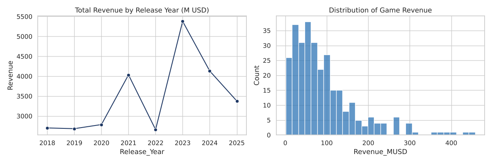
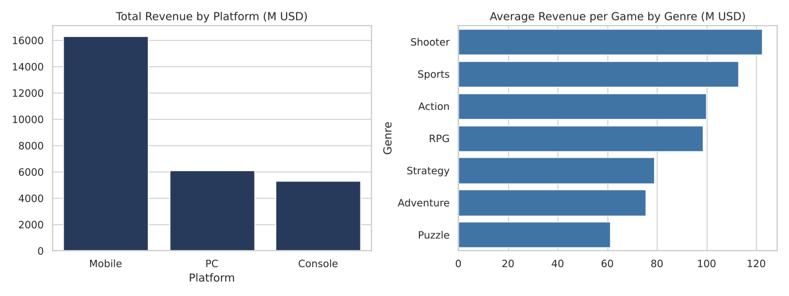
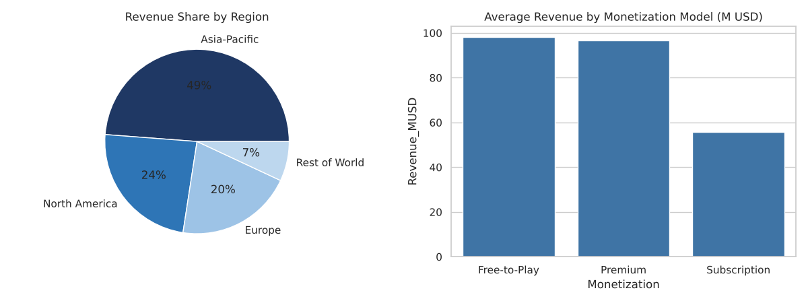
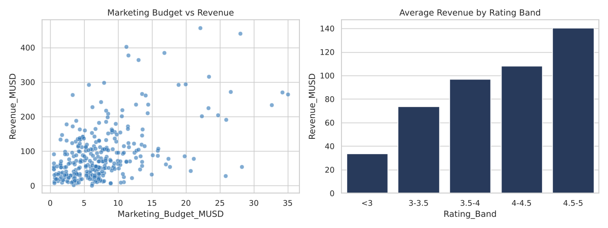
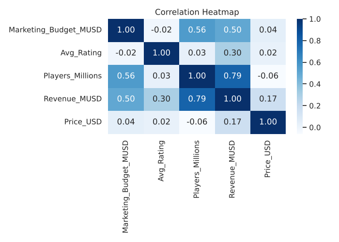

# Gaming Industry Analysis (Data Analyst Project)

A beginner-friendly data analysis project built during the **HCL Internship Training Program (Data Analyst)** at ABES Engineering College.
It analyses which platforms, genres, regions and business models earn the most revenue, using Python, pandas, matplotlib and seaborn.

> The dataset is **synthetic** (computer-generated) for learning. It is **not** official industry data, so the findings are illustrative.

## Business problem
A gaming publisher wants to know where to invest by understanding which platforms, genres, regions and monetization models generate the most revenue.

## Questions answered
1. How has the industry grown over the years?
2. Which platforms and genres earn the most?
3. Which regions and monetization models perform best?
4. Do marketing budget and ratings affect revenue?
5. Which games are top performers?

## Dataset
`data/raw/gaming_industry.csv` – 305 rows, 11 columns (Game_ID, Release_Year, Platform, Genre, Region, Monetization, Price_USD, Marketing_Budget_MUSD, Avg_Rating, Players_Millions, Revenue_MUSD).
The raw file intentionally has missing values, duplicates, inconsistent text and an impossible rating, so cleaning can be practised.

## Project structure
```
Gaming_Industry_Analysis_Project/
├── data/
│   ├── raw/gaming_industry.csv
│   └── processed/gaming_industry_clean.csv
├── notebooks/gaming_industry_analysis.ipynb
├── images/                  (charts saved by the notebook)
├── scripts/generate_data.py (creates the synthetic dataset)
├── requirements.txt
├── .gitignore
└── README.md
```

## How to run
```bash
git clone https://github.com/<your-username>/gaming-industry-analysis.git
cd gaming-industry-analysis
pip install -r requirements.txt
jupyter notebook notebooks/gaming_industry_analysis.ipynb
```

## Steps followed
1. Load and inspect data  2. Clean data (duplicates, text, outliers, missing values)  3. Create new columns (Revenue_Per_Player, ROI, Rating_Band, Revenue_Tier)  4. Exploratory analysis with charts  5. Insights and recommendations

## Key findings (from this dataset)
- Total revenue is about 27,751 M USD across 300 games.
- Mobile is the top platform by revenue; Shooter is the top genre by average revenue per game.
- Asia-Pacific contributes about 49% of revenue.
- Marketing budget has a moderate positive correlation with revenue (0.50); rating is weaker (0.30).
- Free-to-play games earn the most on average (about 98 M USD per game).

## Charts






## Tools
Python 3 · pandas · NumPy · matplotlib · seaborn · Jupyter Notebook · Git and GitHub

## Author
Hridyansh Sahai – B.Tech 1st Year, CSE-7, ABES Engineering College
